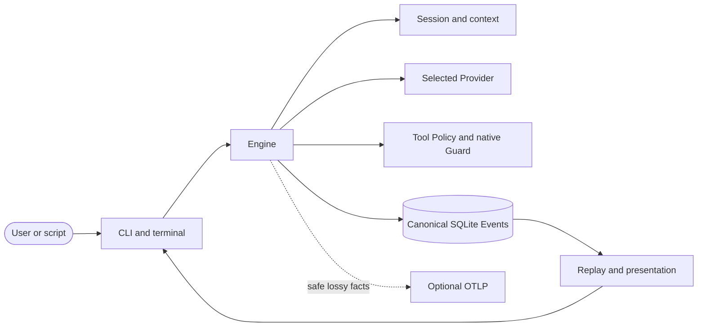

# Arany: product and architecture map

Arany is a Rust CLI agent harness. It owns durable Sessions, bounded Runs,
context, Tool authority and recovery. One primary AgentRun answers the user;
optional direct children contribute isolated read-only work.

The Engine owns policy and coordination. Provider adapters translate external
model protocols. The terminal presents committed facts. Tool effects cross a
separate enforcement boundary; telemetry cannot determine durable state.

## Read the owner

| Question | Owner |
|---|---|
| Physical modules, data model and dependency direction | [System overview](./system-overview.md) |
| Run coordination, delegation and budgets | [Execution spec](../specs/execution.md) |
| Session lifecycle, resume, fork and context | [Session spec](../specs/session.md) |
| Terminal interaction, accessibility and machine output | [Terminal spec](../specs/terminal.md) |
| Account scope, storage and recovery | [Credential spec](../specs/credentials.md) |
| Provider admission and billing route | [Provider spec](../specs/provider.md), [ChatGPT spec](../specs/chatgpt.md) |
| Files, commands, runtime Skills and MCP | [Tool spec](../specs/tools.md) |
| Trace export | [Telemetry spec](../specs/telemetry.md) |
| Reasons and alternatives | [Decision register](../research/next-step-decision-register.md), [research index](../research/README.md) |
| Missing functionality and platform evidence | [Next steps](../../NEXT_STEPS.md) |

[The documentation map](../README.md) locates additional contracts and editing
rules. This introduction does not maintain a second feature list, limit table,
implementation status or release checklist.
