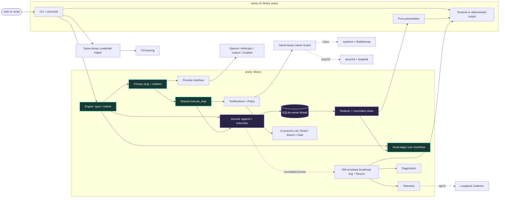

# Arany beta architecture

**Status:** maintained architecture; implementation and verification gaps remain in next steps

**Design rule:** build a familiar durable harness, then deepen it without replacing its Engine

This document owns physical architecture, data model and responsibility boundaries. [Product specs](../specs/README.md) own observable contracts. [The documentation map](../README.md) locates those owners, and [next steps](../../NEXT_STEPS.md) owns current defects and verification debt. Research and the [decision register](../research/next-step-decision-register.md) retain source evidence and rationale. Anything absent here is not an empty module waiting to be scaffolded.

[D-17](../research/next-step-decision-register.md#d-17--product-identity-platforms-and-license)
owns product identity, platform scope and the distribution license.

Read the section for the affected boundary:
[runtime ownership](#2-runtime-architecture), [module entry points](#3-physical-beta-shape),
[Session lifecycle](#5-session-run-and-collaboration-lifecycle),
[context and effects](#6-context-and-compaction), [persistence](#7-canonical-persistence),
[presentation](#8-terminal-presentation), [Providers](#9-provider-profiles-and-custom-endpoints),
[telemetry](#10-telemetry-and-diagnostics), or [security](#11-security-boundary).

## 1. What the beta must prove

Arany is an interactive Session-oriented CLI, not a one-shot team demo. Bare `arany` opens a local conversation and creates its durable Session on the first task submission; every accepted user Message starts one bounded Run; each Run has one accountable primary AgentRun and may admit a bounded mixed team of direct researchers and EditOnly workers.

The full product contract is successful when it proves all of these together:

1. a Session survives process exit, explicit resume, multiple Runs, provider changes between Runs, compaction, and deterministic replay;
2. `single`, `auto`, and `team` policies all use the primary coordination loop and a generic ordered child collection rather than a fixed two-worker shape;
3. the primary cannot finish team work before every required child has a persisted terminal disposition;
4. the default fullscreen terminal keeps a navigable committed transcript on the alternate screen (Classic inserts it into native scrollback), conditional agent activity above a bottom composer, a slash menu below input when open, and a compact status row;
5. keyboard access is complete, while mouse reporting exists only in fullscreen or transiently inside an open picker or detail panel;
6. native OpenAI and Anthropic plus every admitted exact custom endpoint/model profile satisfy the same semantic Provider contract;
7. bounded instruction discovery follows the [Session admission contract](../specs/session.md#workspace-admission-and-authority);
8. `exec` and `show` expose the same committed facts without terminal initialization; and
9. cancellation reaches the primary and every admitted child without fabricating completion; and
10. explicitly enabled primary Tools use typed one-use intents, restrict-only Policy, native Guard enforcement for programs and capability-scoped file publication, bounded continuation and durable non-executing replay.

Startup resolves trusted user/process configuration, admits a private state root outside the Workspace, admits [per-role Provider routes and configured fallback chains](../specs/provider.md#per-role-selection-and-fallback), and pins the caller-selected Workspace before consuming project-controlled input. Admission never executes or discovers Git/repository configuration, `.env`, hooks, plugins, packages, tests, or startup commands. Instruction and explicit include files remain bounded immutable no-follow snapshots. Explicit include data preserves its escaped relative path and raw-file SHA-256 alongside untrusted text; the full envelope counts toward context admission. Untrusted and ordinary headless Runs are read-only. Attached folder trust generates a user-owned, directory-pinned grant; `--tools` loads an explicit private grant. Both use the separate native Guard described in [local tools](../tools.md): Linux and macOS admit typed files, pinned Skill data, offline commands and local MCP through their separately attested native profiles. Unsupported native enforcement fails closed. The primary-only [host-command exception](../specs/tools.md#primary-host-commands) requires explicit human or admitted user-owned rule authority and a pinned, supervised command, never automatic fallback. Engine owns live epochs and journaled scope/reuse validation; Tools owns executable admission and supervision. Host effects cannot be published as Guard changesets or rewound, and the same user can modify Arany state and journal.

Tools owns one private model-input projection shared by the native adapters. It exposes structured bounded catalog/output data and ordered call/disposition/workspace-effect facts, while keeping journal intent identities, enforcement digests, limits and receipts out of current Tool observations sent to the model. Canonical Tool observations retain all enforcement evidence; projection changes neither authority nor replay. Native Run adapters use the [Provider text-answer and automatic Tool-selection contract](../specs/provider.md#structured-outcomes-and-tool-encoding). The adapter reconstructs paired model action/result items with request-local correlation labels and carries each model-action observation only in its result item. Engine-generated integration outcomes use separate untrusted user-data records, with no fabricated model function or advertised integration operation. The adapter omits the duplicate observation list from the task-data envelope. Provider instructions explain continuation and completion evidence independently of untrusted result text.

## 2. Runtime architecture

The workspace has two crates: the `arany` library owns the harness, and
`arany-cli` produces the `arany` executable. One long-lived Engine serves each
process. The CLI calls `Engine::open(state, EngineConfig)` once, then
`submit(providers, request, controls) -> RunHandle` for each submission. The
handle exposes cancel, steer, approvals and events; completion yields
`RunResult { run, stopped }`. The CLI/account edge constructs an admitted Provider bundle per submission: four role chains plus an optional immutable named roster. JSON file types and credentials stay at that edge; the Engine independently validates bounded semantic snapshots, named identities and fixed role defaults. RunStarted pins the cross-validated roster/digest with role provenance. Children carry typed objective/profile assignments; the Engine resolves eligible references and commits them in AgentSpawned before any dependent call. Routing derives each child chain from its actor and immutable profile, keeping review/compaction at their fixed roles; no new process or privilege boundary is added.
A concurrent submission or compaction is refused with `EngineError::Busy`;
Session and ancestor locks remain scoped to a Run, while the Store thread lives
until the Engine is closed or dropped. The [execution contract](../specs/execution.md#admission-persistence-and-recovery)
owns Engine lifetime and admission.
The binary's `serve` Server owns a bounded submission/response channel loop over
that Engine. Its stdio adapter, ACP translator, attached terminal, headless `exec` and in-process conformance
adapter use the same loop. ACP maps its private wire subset into the serve
vocabulary at the binary edge; its translator owns the exhaustive typed Tool
projection and preserves serve's Move FileChange path while giving GhPrList an
explicit read projection. Each active submission has an owned task driving
its RunHandle while the Server projects its committed Event subscription; bounded client backpressure
cannot hold Journal appends. The library has no protocol or transport dependency. Supervised stdio avoids
listener and discovery ownership; browser or multi-client transports require
the separate admission and recovery design in the [Serve contract](../specs/serve.md).

Production entry points poll the Engine on the process main thread's current-thread Tokio runtime.
Any new production thread hosting the Engine, including a multi-thread runtime worker,
must set an explicit stack size of at least 8 MiB.

The Engine owns admission, scheduling, context, Goal accounting and Run
transitions. `GoalLedger` admits, reserves and settles actions over the reducer's
`GoalView`, with `Action::max_events` owning Event headroom. Primary, researcher and editor Tool steps share `execute_step`: reservation, committed intent,
approval, dispatch, committed observation and continuation have one owner.
Tools owns the `ToolGrant` value supplied for a submission; the Engine consumes
it during admission, so the source dependency points from Engine to Tools.
Engine permission selection, host session reuse and remembering eligibility live
in `crates/arany/src/engine/run_loop/step/permission.rs`; its result enters the
shared ask and dispatch flow. Focused definition-mode and typed-prefix approval
tests live with that permission policy.
The Engine composes per-dispatch queue progress, active-action and checkpoint
senders through consuming ToolRuntime builders; Guard dispatch makes one owned
copy from its borrowed runtime before consuming that chain.
The Session reducer owns shared editor-request validation, and the Engine consumes its typed causes. The [execution contract](../specs/execution.md) owns refusal and failure behavior. Editor base capture and primary handover integration use `primary_intent`/`run_intent` directly rather than `execute_step`.
Only the primary integrates changesets. The Engine coordinator owns the bounded immutable worker base, acknowledged overlay and pending handover bytes for the live Run; no native filesystem persists across worker calls. The reducer owns canonical leases, target revisions, data references, worker dispositions, integration and verification. Guard owns each disposable file or command view and its private cache restore, attests private mutation/capture and publishes only the primary's eligible changeset. Editor commands use the shared permission and delegated hook path; the coordinator gates answer on private evidence before handover, while primary verification remains independent. Journal acknowledgments advance in-memory worker state, never the reverse. The [execution contract](../specs/execution.md)
and [Goal contract](../specs/goals.md) own lifecycle, budgets and recovery.

The RunLoop owns wave-primary request assembly; the [Execution collaboration contract](../specs/execution.md#collaboration) owns its preparation and admission ordering.

The Engine owns the Supervisor's bounded evaluation state and pure evaluator over committed reducer facts. The RunLoop explicitly decides whether to journal a shadow verdict and commits that verdict as its own Event before continuation. The reducer owns only the recorded-verdict projection and shape/placement validation; replay accepts recorded decisions without reevaluating signals. The Supervisor does not subscribe to the lossy tap and has no enforcement authority. The [Supervisor contract](../specs/tools.md#supervisor-adapter) owns signals, bounds and replay.

`Journal::append` publishes only committed Events to a bounded broadcast ring of
256 envelopes. Clients, telemetry and diagnostics each subscribe to that tap;
a lagging receiver gets `Resync { missed }` and rebuilds from the committed view.
Observers never block control flow or authorize work. Provider previews remain
separate provisional data. The tap belongs to Journal rather than the Store
thread so persistence does not own observer delivery. [Execution](../specs/execution.md#committed-event-stream),
[telemetry](../specs/telemetry.md) and [diagnostics](../specs/diagnostics.md) own
their observable contracts.
Provider-owned diagnostic stage, count, response-shape and Tool argument shape
types live in `provider/diagnostics.rs`, including argument shape construction
and Debug formatting. Provider also owns stream/failure/context entry points and
record construction; the Engine calls its context-exhaustion entry point.
Root `diagnostics.rs` retains the bounded private sink, including activation,
locking, sanitization and file admission, without a production Provider dependency
or re-export. Provider depends on that inert-record sink in one direction only;
unrelated root Engine/Event/Tool producers remain at root.



Provider is the substitutable semantic inference interface. Wire adapters stay
behind it; SQLite, replay, reducers and Tool dispatch remain concrete owners.
`ProviderKind` owns native profile names, credential classification, catalog/check
dispatch and custom-profile syntax; public strings are parsed at those edges. Telemetry
maps those closed categories to its existing fixed labels.
The CLI depends on `arany`; the library never depends on CLI, terminal,
presentation or accounts, and has no ratatui, crossterm or keyring dependency.
`accounts/` owns ChatGPT OAuth, saved API accounts and the credential helper.
Terminal rendering and pure view projection belong to the binary.

Tool operations remain a closed enum with one facts table and per-family
dispatch: a `dyn Tool` registry would duplicate a closed set without adding
substitutability. Per-variant operation structs wait until a family payload
gains a third caller. Model-facing schemas remain hand-written to preserve
descriptions and byte-stable ordering; a derive needs caching evidence and a
byte snapshot before reconsideration. Guard adapters remain `cfg`-selected
functions because the host kernel, not runtime configuration, selects them.

Researcher children are direct read-only AgentRuns: without Tools they make one reasoning
call; with Tools they may make up to 16 read-only Tool calls before reporting.
Run-scoped foreground/background editors use leased private bases/overlays through the shared Tool step,
return one handover each and wait for primary integration and fresh criterion verification.
Explicit ID reassignment creates a fresh attempt; the reducer projects historical dispositions and lineage,
while native Guard admission alone owns abandoned-storage containment and cleanup.
The [researcher contract](../specs/execution.md#researcher-children) owns their
catalog, budgets, ordering and failure rules; children never inherit a broader
grant than their parent.

Exact Read, exact-file Search and Skill text use the admitted directory capability
in process.
Observations carry `Attestation::{InProcess, Guard}`; the reducer validates the
execution site. Typed Workspace mutations and changeset publication use the same admitted handle
in process, with digest preconditions and journaled File receipts. Typed Git reads,
Discovery, Skill loading, programs and MCP stay behind the separate Guard. The [Tool contract](../specs/tools.md#in-process-file-operations) owns
path checks, bounds and attestation; its [Linux](../specs/tools.md#linux-enforcement-and-compatibility)
and [macOS](../specs/tools.md#macos-enforcement-and-compatibility) sections own
native launch, supervision and recovery. Short-lived same-binary Guard and
credential helpers are privilege boundaries, not Clients or daemons. A short-lived
same-binary host launcher establishes a fresh OS session before executing an
authorized host command; the Engine owns approval and the parent owns supervision.

The current-thread Tokio coordinator owns async lifecycle. One named
standard-library thread owns the synchronous SQLite connection; a bounded
worker owns OTLP export. Store and Guard share `private_fs` for directory-handle
and ACL admission without sharing history or Tool policy. Native capacity and
storage recovery remain private to Guard admission, outside canonical Events.
The macOS Tool controller awaits a blocking lifecycle owner with a private
reactor, keeping native teardown off the terminal reactor. Abandoning the await
cancels that owner; the dispatch marker distinguishes pre-GO refusal from
uncertain execution.

## 3. Physical beta shape

These are responsibility entry points; private file layout follows the source
modules.

| Responsibility | Owner | Contract |
|---|---|---|
| CLI grammar and composition | `crates/arany-cli/src/cli/`, `main.rs` | [Terminal](../specs/terminal.md) |
| ACP translator over the channel Server | `crates/arany-cli/src/cli/acp/` | [ACP](../specs/acp.md) |
| Stdio protocol and channel Server | `crates/arany-cli/src/cli/serve/`, `protocol/` | [Serve](../specs/serve.md) |
| Terminal and pure view projection | `crates/arany-cli/src/terminal/`, `presentation/` | [Terminal](../specs/terminal.md) |
| Saved API accounts, OAuth and credential helper | `crates/arany-cli/src/accounts/` | [Credentials](../specs/credentials.md), [ChatGPT](../specs/chatgpt.md) |
| Run admission, Goal ledger and shared Tool step | `crates/arany/src/engine/` | [Execution](../specs/execution.md), [Goals](../specs/goals.md) |
| Events, reducer, context and replay | `crates/arany/src/session/`, `store/` | [Session](../specs/session.md) |
| Committed Event tap | `crates/arany/src/journal.rs` | [Execution](../specs/execution.md#committed-event-stream) |
| Semantic inference and wire adapters | `crates/arany/src/provider/` | [Provider](../specs/provider.md) |
| Tool admission, Policy, dispatch and native Guard | `crates/arany/src/tools/` | [Tools](../specs/tools.md) |
| SQLite, private records and shared filesystem admission | `crates/arany/src/store/`, `private_fs/` | [Execution](../specs/execution.md#admission-persistence-and-recovery), [Credentials](../specs/credentials.md#account-scope-and-identity) |
| Lossy export, bounded private sink and Provider stream/failure/context records | `crates/arany/src/telemetry/`, `diagnostics.rs`, `provider/diagnostics.rs` | [Telemetry](../specs/telemetry.md), [Diagnostics](../specs/diagnostics.md#acceptance-and-evidence-owners) |

[Testing](../../agents/testing.md#corpus-placement) owns corpus placement and
shared support. [Library](../../agents/arany.md) and
[binary](../../agents/arany-cli.md) editing notes route this work.
Guard helper entry points remain reachable from the binary's `main.rs`.

## 4. Public command contract

[The terminal spec](../specs/terminal.md#entry-modes-and-channels) owns attached entry, interactive controls, deterministic channels and their acceptance scenarios. [Account setup](../setup.md) and [local tools](../tools.md) are user procedures; the compiled CLI/command registry owns exact syntax. The spec also owns admission ordering, typed error classification and command-specific composition.

`main.rs` selects attached chat, setup, `exec`, `show` or Provider operations. Private CLI callers resolve trusted inputs and call Engine operations; they do not implement Run transitions or wire decoding. Attached new/clear entry keeps a bounded empty conversation projection and its selected defaults/title local, with zero creation and last sequence; the first task submission delegates creation to the Engine before Run admission. Exit and resume discard that unsaved projection without deleting canonical state. No Events or resumable ID are invented. Continue/resume/fork delegate to the Engine, which revalidates the pinned Workspace and canonical lineage. Headless `exec` creates one Run in a new Session by default; append requires an explicit Session ID. `show` uses strict read-only replay. There is no `run` alias.

The attached composer, slash handlers and quick selector share the compiled local controls and existing defaults/admission owners. Provider selection, saved-account identity, billing-route choice, catalog discovery and Run authority remain separate operations. Typed busy/defaults rejection can recover in chat, while State/replay/terminal failures retain their fatal boundary. A failed operation is not a rollback or retry grant.

Attached setup keeps entry routing and setup-journal coordination in `cli/attached/setup.rs`. Its private `setup/error.rs` owns setup error classifications and conversions, including operation-specific native save/removal, ChatGPT removal/authorization/keyring and custom-write mappings and diagnostic recording. The error type is re-exported through the existing setup module path. Journal disposition and settlement remain with the flows; safe custom-check status vocabulary stays with its display owner. Native account presence lookup, inspection, saved-access resolution and selection live in its private `setup/native.rs` flow; credential storage and key access remain owned by `accounts/credentials/`.

Native removal, its journal settlement and checked saved-setup reset also live in `setup/native.rs`; setup retains mixed-route removal dispatch and the shared uncertainty test bridge. The flow borrows the existing journal and terminal without changing account authority or publication ordering.

Explicit `--tools` reaches the same private Engine/Policy/Guard admission from attached and headless composition. The CLI supplies the shipped executable identity and private configuration root, not an alternative Tool runtime or per-effect approval service.

## 5. Session, Run, and collaboration lifecycle

The lifecycle hierarchy is:

```text
Session
├── durable messages, title, fork lineage, defaults, compaction snapshots
└── Goals[] in accepted-task order
    ├── accepted objective, Workspace identity, bounded budgets, plan and terminal report
    └── Runs[] linked to exactly one Goal
        └── Run
            ├── pinned ProviderProfile/model/policies/budgets
            └── AgentRuns[]
                ├── one primary
                └── ordered 0..N direct children
```

A Session has at most one active Run in beta. Every accepted task is a durable Goal linked to one or more Runs; Goal budgets, the initial plan contract and terminal report are canonical Events projected by Session replay. Write-capable Goals also hold the OS-user Workspace identity lock, so separate Session StateRoots cannot concurrently publish to one Workspace. The Engine holds a private per-Session state lock across each Run, source fork, and manual compaction; a brief private namespace lock coordinates file creation and removal while other Sessions can proceed independently during work. At most 65,536 Session lock files may exist, including crash-stranded pre-commit files. Completed, failed, cancelled, and interrupted Runs remain immutable history. Resume reconstructs the same Session; fork creates a new Session with a single `SessionForked` first Event recording source Session, boundary Run, boundary sequence, and canonical Event-prefix digest. Store replay validates bounded source ancestry; the context compiler selects successful inherited turns only through that boundary. Historical children remain inspectable but are never recreated as live work.

Before each Run, Arany pins one collaboration policy:

```text
single
  maximum total direct children = 0

auto(max_active_children = N)
  primary may delegate only when independent work is useful

team(max_active_children = N)
  primary must propose a non-empty team decomposition
```

The product default is `auto` with at most three total direct children. The historical field name `max_active_children` bounds total delegation size, not only simultaneous dispatch. `N` is a numeric input and bounded by policy, process safety and remaining call/token/byte/time budgets. The separate Provider concurrency ceiling limits simultaneous calls; admitted children can wait in the ordered queue. Children cannot create nested teams in beta.

The semantic Provider outcome is:

- `Answer { text }`, a plain text answer;
- `Delegate { children: bounded ordered objective/profile assignments }`; or
- `Tools { calls: bounded ordered list of closed typed operations }`, under the existing per-role Tool restrictions ([execution contract](../specs/execution.md#accepted-outcomes)).

In `single`, the primary finishes without delegating. In `auto`, it decides from the current task whether substantial independent read-only reasoning justifies the extra calls and duplicated context; routine edits, direct questions and tightly coupled work should remain with the primary. The shared native guidance requests the smallest useful team and distinct evidence-backed assignments; history and Skills never require a team. This is model guidance within the enforced ceiling, not a task classifier or a guarantee of optimal model judgment. In `team`, its first non-Tool outcome must be a nonempty bounded delegation. Every child is read-only: one reasoning call without Tools, or up to 16 read-only Tool calls before its report in a Tool-enabled Run; after all required children finish, primary synthesis may use the same remaining Goal budget before finishing. Without Tools, a successful team with `k` children uses `k + 2` Provider calls and a direct answer uses one. The [Goals contract](../specs/goals.md#lifecycle-budgets-and-recovery) owns shared defaults and selectable finite limits; a finite token limit admits only one concurrent Provider call. The Engine reserves each actual call/effect atomically with its bounded terminal tail; read-only inspection and Tool history compact within the admitted request budget instead of stopping at a fixed per-Run step count. Per-request, output, Tool, Run, Store and Guard bounds remain finite. Reported input usage above 1,000,000 tokens or output usage above the exact request cap fails at each public production adapter, including standalone library calls; Engine validation remains defense in depth. Native OpenAI can retain unknown usage, while exact custom transport requires positive reported usage. Transient Provider failures retry the same route within the [reliability bound](../specs/provider.md#usage-provenance-and-reliability) before configured, admitted [fallback chains](../specs/provider.md#per-role-selection-and-fallback) switch.

Context is isolated per AgentRun. Children receive explicit assignment capsules and narrower-or-equal authority, never a shared mutable prompt. Only the primary writes the final assistant Message.

## 6. Context and compaction

### Local effect ownership

The [Tool contract](../specs/tools.md) owns supported behavior and acceptance scenarios. [Guard research](../research/deterministic-harness-protection.md#linux-launch-and-syscall-rationale) and [MCP/Skill research](../research/mcp-and-runtime-skills-2026-10.md) retain alternatives and rationale; [dependency review](../security/local-tool-dependency-review.md) owns scoped security evidence. `tools.json` is private host configuration, not repository configuration. Its pinned scope/resource digests produce immutable primary-only one-use intents. The Engine commits each Provider request fact and intent before dispatch, then a correlated observation before inferring again. Uncertain, cancelled or unacknowledged effects stop without retry; public typed replay validates payloads as well as legal transitions. Replay accepts only the current Goal-linked format and never grants authority from an older or incomplete journal.

The Linux Guard verifies namespace/capability/seccomp and effective cgroup limits before payload release, owns the exact invocation and retained cgroup through cleanup, and reports a digest-bound receipt. In-process file operations use live no-follow handles and digest/create-preconditioned fresh-inode replacements. Commands/MCP instead receive fresh private selected-file snapshots, no network or accounts and bounded memory/PID/CPU/time/scratch; commands return bounded changesets after descendant termination; MCP writes remain disposable. Engine journals command results and routes a separate receipt-bound internal integration through the in-process file publisher, validating all file preconditions before publication. Skills are pinned progressive guidance/resources, never permissions. YAML/schema work occurs only inside this killable boundary. MCP supports exactly the 2025-11-25 local stdio tools profile, with bounded negotiation/catalog/schema/framing/calls and no automatic retries. [The Tool contract](../specs/tools.md) owns the supported subset and [tool guide](../tools.md) explains setup, not a claim of arbitrary build/runtime compatibility.

Past effect records enter context/compaction only as bounded untrusted facts, including interrupted attempts and observed failures, never renewed permission or execution. The tool-enabled compiler reserves current observations from the remaining finite context budget. An active Goal may summarize only an acknowledged Tool prefix at a Run boundary; it retains every observation in canonical Events and sends the latest untrusted summary plus a bounded recent tail. Researcher children receive a read-only catalog and only their own observations; the primary receives their bounded reports.

### Conversation context

Session history is local canonical state. Provider conversation IDs, cache keys, and opaque compaction items are optional accelerators.

The deterministic context compiler selects trusted instructions, the current user Message, bounded recent Session history, valid compaction material, explicit include snapshots, and required child results under the local finite content and encoded-request byte limits. It records what was included and excluded. Exact context-window metadata is used only when trusted for the admitted route/model; when unavailable, Arany retains conservative byte limits and makes no expanded-window claim. Provider switching between Runs recompiles from Arany state.

Provider-neutral textual compaction uses the Provider's separate semantic `compact` operation rather than inventing an AgentRun. Accepted conversation outcomes, including unanswered objectives, and an optional prior summary enter that call; the model-authored result remains untrusted derived data. A later `RunStarted` pins the selected snapshot Event and content digest.

Compaction never replaces or deletes canonical history. `/compact` creates a derived snapshot for an exact committed Session prefix and records:

- covered Run/sequence and source digest;
- Provider, model, prompt/schema/compiler versions;
- bounded summary or compatible opaque Provider item;
- byte/token estimates and content digest; and
- completion/failure provenance.

Manual compaction runs only while idle and makes its Provider usage visible. Each new `RunStarted` records actual selected context-content bytes, its compactable Session-history share, and the policy-adjusted byte budget. After a successful attached Run reaches 80% of that budget with at least 10% compactable history, 24 of the 32 selectable history Runs, or the separate source-pressure threshold, Arany prints a durable warning after the confirmed receipt, then attempts automatic compaction for that exact committed boundary using the Run's pinned Provider/model/effort and account source. The source guard reserves two maximal canonical turns below the independent 256-KiB compaction-input cap, accounting for the pre-reply footprint and the previous unchecked turn; canonical Message and image-metadata limits have shared owners. Continuously maintained successful conversations can therefore compact before their source grows beyond the call's bound. This does not recover every unmaintained or failure-heavy prefix; oversized source still rejects before egress. The private CLI passes the committed config rather than mixing its tuple with newer Session defaults; an absent saved account remains the original environment-backed/custom source, while a recorded API or ChatGPT account is re-admitted by identity and current evidence. Replay grants no credential authority. A large immutable Workspace input alone cannot trigger a call that would not relieve pressure. The Engine checks the expected Run ID and prior attempts under the Session lock, so a stale warning or concurrent compaction does not spend another call for that boundary. Compaction composition separates safe operation failures and explicit interruption from terminal-owner errors: committed/admission failures receive labeled chat feedback, interruption warns about uncertain commitment, and terminal failure propagates to restoration and exit. None changes the already confirmed Run outcome or automatically retries. `exec` makes no hidden post-Run Provider call. Failure leaves the Session intact; an incompatible or digest-mismatched snapshot is ignored with a typed failure. Cross-Session Memory remains deferred and distinct.

## 7. Canonical persistence

One strict SQLite Event journal remains product truth. Standalone custom/native checks use its separate CheckId stream through CheckJournal and CheckReducer, without conversation identities; the [execution contract](../specs/execution.md#standalone-provider-checks) owns its transitions and bounds. Store owns the separate derived checkpoint SQLite store and pre-image durability; Guard owns Workspace publications and receives no StateRoot path or handle. Session, Run, AgentRun, SessionView, and RunView are reduced state rather than duplicate authoritative tables. SessionView retains canonical title text, explicit-title provenance and a bounded prefix-derived inherited title; its conversation-title projection is shared by status, resume feedback and human exports. These facts add no Event schema or persisted display cache.

```sql
CREATE TABLE events (
    sequence       INTEGER PRIMARY KEY,
    session_id     TEXT NOT NULL,
    run_id         TEXT,
    agent_run_id   TEXT,
    kind           TEXT NOT NULL,
    event_version  INTEGER NOT NULL CHECK (event_version >= 1),
    payload        TEXT NOT NULL CHECK (json_valid(payload)),
    created_at_ms  INTEGER NOT NULL
) STRICT;

CREATE INDEX events_by_session ON events (session_id, sequence);
CREATE INDEX events_by_run ON events (run_id, sequence) WHERE run_id IS NOT NULL;
```

The initial vocabulary is intentionally small:

- `SessionStarted`, `SessionRenamed`, `SessionDefaultChanged`, `SessionForked`, `ContextCompacted`;
- `MessageAccepted`, `MessageCommitted`;
- `RunStarted`, `RunFinished`;
- `AgentSpawned`, `ProviderCallRecorded`, `AgentFinished`; and
- `ToolStarted`, `ToolFinished`.

All current Events use the payload version the [execution spec](../specs/execution.md#admission-persistence-and-recovery) owns. Goal Events pin the user-approved usage/resource settings and record call, active-time and compaction reservations alongside terminal reports. Tool Events correlate the exact Run, acting AgentRun, one-use intent, pinned policy/enforcement digest, Workspace identity and finite effective limits. A successful observation requires a matching Guard receipt. Unknown, duplicated, unmatched, over-budget or mismatched transitions reject; uncertainty/cancellation cannot be followed by successful Agent completion. Public typed replay validates payloads as well as SQL loading. A started attempt without a terminal observation remains a past interrupted/uncertain fact, never an approval or retry instruction.

Event encoding borrows from in-memory facts; decoding retains owned, strict payload records. Both preserve the canonical serialized bytes and current payload versions described by the [execution contract](../specs/execution.md#admission-persistence-and-recovery).

`SessionStarted` pins the admitted Workspace device and inode atomically with the title, including for an empty Session. Replay rejects a later Run or fork whose identity disagrees with the pinned Session. The SQLite owner admits only the current registered SQLite schema and Event payloads; unsupported formats and missing fields reject without conversion or deletion, and older supported journals are upgraded only by the startup [journal migration](../specs/execution.md#journal-migration).

Provider/profile, collaboration policy, limits, instruction digest, and Workspace snapshot facts are fixed in `RunStarted`. Provider owns the closed `ProviderRecord` kind/name representation; the Engine translates its admitted runtime identity into that record and Session validates it before reduction. Store owns the migration from string Run identities and re-pins historical prefix references; runtime replay has one current representation. The CLI account and configured-route owners also persist this tagged record, translating profiles only at runtime edges. Their registered migrations preserve credential binding and selected-source behavior; keyring read upgrades remain in memory, while StateRoot owns atomic private-file publication. Each observed Run call then records its phase, local disposition, bounded response ID, provider-reported token usage, and accepted wire provenance when available before the relevant AgentRun finishes. Compaction records carry the same optional wire provenance. The closed values distinguish Responses `completed` plus a local `store: false` request from Messages `end_turn` with no equivalent request switch; they do not assert remote retention, account-level Zero Data Retention, or a custom endpoint's compliance. A cancelled or timed-out call has unknown usage and wire provenance, not zero; cancelling the Run after a call has returned preserves its observed record and any known usage. Sticky cancellation wins before either successful or failed primary terminal commitment starts, without rewriting earlier child outcomes. Once that commitment starts, it completes or leaves an interrupted prefix on Store failure. Replay validates ordered observed calls and explicit provenance fields; missing current-format fields reject. A logical transition commits before reduction or feedback. A crash leaves a valid prefix; replay labels incomplete work `Interrupted` rather than inventing cancellation or success.

Recognized typed Provider failures retain an optional closed reason for account access, usage limits, rate limits, temporary usage or service unavailability, stream protocol, response contract, structured outcome contract or local output acceptance. Every call uses the current Event version with an explicit nullable reason. Strict admission rejects a reason inconsistent with its disposition. Raw HTTP status, stream code, upstream text/body and request IDs are excluded. Chat feedback and agent details translate the last call of a failed AgentRun into compiled recovery guidance; cancelled siblings and successful calls cannot supply its cause. Linear modes append the same feedback after their confirmed receipt. This metadata does not enter Provider context or traces, prove a billing diagnosis, trigger retry or switch account routes. Compaction keeps its separate existing failure categories.

Idle rename/default changes may follow an interrupted prefix without submitting another objective. Their committed Session-only facts seal the unfinished predecessor, preserve its observations and prevent later transitions under that abandoned Run ID. The [Session reducer contract](../specs/session.md#persistence-facts) owns this recovery rule; lifecycle operations hold the existing per-Session lock to exclude a live Run. No interruption Event or synthetic terminal outcome is added, and fork/compaction still require their existing committed boundary.

Before Run effects or Provider usage, the Store strictly checks the resolved lineage count plus the complete worst-case lifecycle/children/Tool Event envelope in an immediate transaction. Its database byte preflight covers each slot's maximum ordinary payload and bounded SQLite page/index overhead, one larger image Message, and the unchanged per-append floor; the floor alone cannot fund the later receipt/closure writes. Engine retains operation locks for the Session and all ancestors because replay counts their full journals, including suffixes outside a fork boundary. Compaction additionally checks its direct Session's lifetime attempt quota; inherited summaries do not charge that quota. Answer admission measures the exact serialized terminal payload, not only raw text. Event-count admission is stabilized by those locks; the byte allowance is a conservative preflight, not a lease against concurrent independent writers or a physical disk reservation. Disk faults and process death still require interrupted/uncertain recovery. Independent lineages remain concurrent.

The sole connection opens in a private owner-verified local state directory with the settings the [Session spec](../specs/session.md#persistence-facts) owns. Rebuildable indexes may accelerate Session listing; they never become canonical.

## 8. Terminal presentation

[The terminal spec](../specs/terminal.md) owns modes, layout, keys, draft retention, selectors, setup presentation, paste, accessibility, process channels and acceptance scenarios. Clipboard and image rules live in its [paste and attachments](../specs/terminal.md#paste-and-attachments) section; implementation invariants live in tests.

`presentation.rs` maps committed SessionView/RunView facts to bounded semantic rows and append-only lines. Tool summaries and approval actions dispatch over the library's closed Tool family and execution site; the CLI owns their per-family rendering, escaping and host disclosures. This is a presentation boundary only: operation facts and authority do not cross into presentation, and the journaled report formatter remains separate. The private terminal module owns the primary-screen viewport, Composer, history index, raw/canonical readers, keys, focus, mouse and one RAII lifecycle owner. Its `Panels` groups selection, copy, cue, picker geometry and help state; private `Transcript` groups the distinct Fullscreen and Classic history indexes, native emission tracking, pager/dump state, Classic adjacency and kept-Tool suppression across release/reacquisition. Linear output, signals, secret echo, clipboard and graphics cleanup retain their separate owners and lifecycle order. None of these presentation types enters the Engine.

The attached Run's private `Drafts` owns offered steering text, linear offers and the held draft, shared by Run input and settlement. Composer owns editing and capacity; the Server owns steering delivery and withdrawal.

Attached Run budget, Escape, approval-reply and current-Run exit-settlement tests live in [run/tests.rs](../../crates/arany-cli/src/cli/attached/run/tests.rs); process and macOS tests retain their separate inline owner in [run.rs](../../crates/arany-cli/src/cli/attached/run.rs).

The presentation layer owns the committed budget-refusal lookup and Run feedback projection. `exec` retains its looser admission-refusal fallback, while committed receipts render the exact Run being reported.

History indexes row counts/source anchors over the already loaded Session view without retaining another full transcript, and materializes only visible message rows. Terminal-local feedback interleaves with those rows but has no canonical or Provider-context authority. The Composer owns the bounded Provider/account-scoped catalog and draft; the CLI's picker owns its cancellable refresh and staged default publication.

The private attached model owner persists token-free `model-preferences.json` under the checked OS-user account root, using the existing account replacement lock and atomic file transport. It holds at most eight exact Provider/account UUID sources, their selected model/effort and up to 4,096 catalog IDs each, bounded to 1 MiB with oldest-source eviction. Current native metadata reconstructs labels; the file contains no compatibility evidence, grant or credential. New bare Sessions reuse matching preferences and seed the Composer cache; explicit flags and resumed defaults win. A first upgrade may copy only a matching tuple from the latest admitted-Workspace Session without inheriting its history. Selection and successful catalog writes remain separate from current account/consent and actual-response admission.

The attached command owner persists token-free `ui-preferences.json` at the selected admitted state root through the existing private replacement lock and atomic file transport. Its closed version 4, 1 KiB record holds slash completion, chat view, Goal usage limits, Build/command resource settings, mouse and copy-on-select; defaults use tabs and fullscreen, and an unsupported or invalid record leaves attached chat, task submission and `/settings` on those defaults until `/settings` replaces it (`exec` and `serve` refuse it). Attached startup reads it read-only before terminal acquisition without creating State; `--classic` pins Classic for that process without changing the record. Engine snapshots only the selected execution values into a Goal before Workspace disclosure; they do not widen Tool grants. The saved record itself never enters Events, account authority or Provider context. The Composer owns tab/focus state and the frame places the bounded list below input, sharing history-capacity geometry with the lifecycle owner.

The channel Server forwards provisional display and capacity waits from the Engine hints handle and committed Events from its Run subscription to the attached terminal over bounded in-process channels. The terminal reduces those canonical Events into its local SessionView and reconciles gaps through a Server snapshot request. The Server owns Run submission, approvals, steering, cancellation and settlement; idle Session operations retain their existing direct Engine calls. The Session shares its Engine with each connection and closes it only after the connection has settled and released its tasks. Before Engine admission, preparing feedback remains presentation-local; afterward activity derives solely from committed current-Run facts. Closed replay and typed CLI classification precede receipt/answer output. Linear output restores ownership first; visual modes retain their owned viewport while inserting classic transcript or emitting redirected confirmed stdout.

Guard's shared capacity wait is a separate one-slot intent-ID hint, validated
against the committed pending Tool before display. It cannot enter history or
authorize/replay work. Linux/macOS Guard own user-level private FIFO/reservations
and validated settings independently of Session roots; Engine owns immutable
intent/approval and aggregate Run deadlines. No native lock or process type
crosses into Engine. [Shared capacity](../specs/tools.md#shared-native-capacity-and-settings)
owns defaults, configuration, resource bounds and interruption semantics.

A terminal-owned clipboard worker has bounded trusted OS-client ownership distinct from the reader and Engine. Immutable image values cross semantic Provider/Session boundaries; human drawing receives metadata. Canonical image bytes, multimodal context and compaction remain under the image/Session/Store owners.

`OwnedTerminal` acquires and owns the active renderer, reader and terminal-mode guards, and restores them in lifecycle order. `AttachedTerminal` keeps signal listeners through committed output and transfers them during reacquisition; secret echo and clipboard ownership stay separate. Suspension retains the pinned Run future and bounded draft; lifecycle failures cannot manufacture a committed outcome. [Terminal spec](../specs/terminal.md#interruption-suspension-and-restoration) owns restoration behavior; [next steps](../../NEXT_STEPS.md) owns unverified claims.

### Display observations and terminal continuity

Provider adapters may publish a bounded typed preview to attached primary execution. The Engine coalesces transient observations, checkpoints safe text through canonical Events and validates the complete outcome before accepting an answer. Display-only checkpoints never enter future Provider context or compaction. Terminal owns provisional labels, sanitized Tool details, reading anchors and classic/fullscreen mode changes. Classic uses Ratatui Inline and native insertion while fullscreen owns an alternate screen; a narrow backend routes cursor observation through the sole input reader and scopes primary-screen clearing. This adds no process, terminal engine or second canonical history store.

## 9. Provider profiles and custom endpoints

One ProviderProfile binds protocol family, normalized endpoint/base path, credential reference, model, outcome encoding, privacy claim, and capability evidence. Native profiles are compiled; each admitted model still requires paid model-scoped live proof before a release claim. Custom profiles live only in trusted user configuration outside the Workspace.

Native API selection carries one closed credential value: Provider, key and optional Anthropic API workspace. The API workspace is a tenant/billing scope, not Arany's filesystem Workspace. Environment-backed Anthropic selections read it explicitly; other Providers and saved accounts never inherit it. Setup offers key-scoped access or a visible explicit workspace ID. Native API accounts retain explicit nullable workspace scope; the [credential contract](../specs/credentials.md#storage-replacement-and-recovery) owns versioned account and backend-marker formats. Aggregate storage caps stay unchanged. The selected-account loader returns the complete validated credential. Its scope is immutable across catalog pages and all native calls and enters the current exact-evidence fingerprint. It authorizes no new endpoint or arbitrary header. The [credential contract](../specs/credentials.md) owns account scope and acceptance scenarios; synthetic success is not live API compatibility.

Native model effort is selected from a reviewed per-model set or resolved to an explicit reviewed default before Workspace input. The native adapter sends the resolved level explicitly on every Run and compaction request, and `RunStarted` pins it for replay. The finite reviewed table contains exact model/effort metadata; account catalogs may contain many more IDs. Custom capability-evidence version 2 binds its exact model and an explicit bounded ordered effort list to the exact profile and fingerprint; an empty list permits only provider-default reasoning behavior, and each declared effort receives a data-free strict finish probe. An admitted explicit choice is sent on every Run and compaction call and pinned in `RunStarted`; omission retains the conformed provider-default behavior. Catalog availability alone does not prove compatibility. Unknown native models may be selected with explicit closed effort without a synthetic check; `resolve_native_effort_for_run` validates their local selection and limits concurrency to one, while the reviewed metadata resolver stays closed. Actual responses follow the [Provider outcome contract](../specs/provider.md#structured-outcomes-and-tool-encoding), including bounded text compaction and strict review verdicts.

`provider models` performs account-scoped native discovery without Workspace data, lists the configured model of an exact custom profile without egress, or lists all visible models of the selected OS-user ChatGPT account. The native command can select either its named environment key or the current OS-stored API account. ChatGPT listing uses only its consent-matched OAuth token and may rotate a near-expiry token under the account lock; it does not use the native API key or a Session StateRoot. Both catalog transports require one JSON media type before bounded body reading. Idle attached `/model` uses the selected native, custom, or account-pinned ChatGPT catalog and a bounded keyboard-accessible page view. Native rows outside the reviewed table disclose availability without compatibility evidence and require explicit effort, not a check; ChatGPT Run admission instead revalidates selected-account identity and current consent without a mandatory probe, while custom entries show their declared effort choices alongside provider default. `provider check chatgpt` explicitly verifies the selected account's catalog row and runs the data-free three-call probe before saving account-bound model/effort evidence; a later Run independently revalidates the selected account and its consent, not that optional diagnostic. The catalog is never consulted implicitly during a Run. An unreviewed native row can be staged as an idle Session model without a Provider inference call; selecting its effort and admitting its Run require current credential/account authority and strict real-response validation, not model-check evidence.

The admission layer reads a versioned `provider-profiles.json` from the existing private state root through a bounded no-follow file handle. It validates the entire closed profile set, including unique names and a one-origin binding per credential reference, before returning the named profile. `arany provider check PROFILE` runs data-free synthetic probes and stores 24-hour evidence in a bounded auxiliary SQLite table. `custom:NAME` selects the exact checked profile and requires an explicit matching model; the custom adapter re-resolves and compares fresh fingerprint/address evidence before reading its key or any Workspace input. Schema version 4 has a separate bounded table for optional native model diagnostics. The explicit, potentially billable native check confirms account-catalog visibility, then reuses the fixed native adapters for strict synthetic direct, delegation, and compaction probes under remote output caps. Its HMAC fingerprint binds protocol/endpoint, model, effort, version, key, API workspace and source/account identity without storing the key. Only opt-in checked library constructors require this exact evidence. Ordinary environment-backed `exec`, attached saved-account Runs and account setup do not require or manufacture probe evidence; strict real-response validation and current credential/source admission remain intact.

Closed custom protocol families begin with `openai-responses`; additional `openai-chat-completions` or parameterized `anthropic-messages` support must earn the same adapter and security review. Arany never accepts arbitrary headers, shell credential commands, repository profiles, raw key arguments, automatic model discovery, or a generic compatibility plugin.

Before a custom profile receives Workspace data, `arany provider check PROFILE` performs a synthetic bounded conformance sequence with no repository content. The checker probes a direct finish, one-child delegation, and compaction through the strict Responses wire format; each declared effort additionally receives a probe with a strict finish. It validates response model, IDs, usage bounds, and bodies. Evidence binds the Arany/check version, exact endpoint and profile fields including the effort list, allowed address set, timestamp, and expiry. After a profile is admitted, a failed recheck leaves no prior evidence for that profile. Each Run admission re-resolves and matches all bound fields and addresses before Workspace disclosure; `RunStarted` records the exact endpoint and evidence fingerprint. The checker and adapter share the same bounded transport and reject raw or decoded exact key reflection. Paid exact-endpoint live proof remains separate.

Receipts use exact support language:

- `native supported`;
- `broker constrained` after a future OpenRouter gate;
- `custom verified`; or
- `custom unverified`, eligible only for `provider check`.

Non-loopback endpoints require HTTPS. Numeric loopback may use explicit HTTP. Redirects, cookies, ambient proxies, DNS/route drift, metadata/link-local/multicast destinations, and credential reuse across origins are rejected. IPv6 domain answers are limited to reviewed allocated ranges; unknown global-unicast space is not assumed routable. “OpenAI-shaped” is never treated as proof of compatibility.

The CLI has two explicit API-key sources: environment references for `exec` and flag-selected attached use, and one protected default native API account for bare new attached use. The [credential contract](../specs/credentials.md) owns current records, account scope, selected-item authorization and recovery. The private record pins either the OS keyring or a user-confirmed plaintext private-file backend. On Linux and macOS the account root resolves from the effective UID's passwd home; its lock serializes replacement against the fixed per-user credential slot. Unsupported records reject unchanged, with no relocation or conversion. A bounded same-binary helper owns OS-store access, cancellation, kill/reap and conservative write uncertainty. Linux uses Secret Service and macOS uses Keychain Services; native scope and human dialog evidence remain separately tracked. The debug-only fixture root is rejected in optimized builds. Cancelling pre-Session `--setup` creates no Session or Run; cancelling in-Session `/setup` leaves that Session unchanged. A failed save is not a rollback guarantee.

A saved unreviewed model requires explicit effort and current selected-account authority before Workspace input, without mandatory synthetic inference. Session defaults pin only the account UUID; Run and catalog admission re-read the record and reject a changed ID or Provider before using its key. The selected native Provider carries the validated UUID into `RunStarted`; environment-backed and custom Runs have no saved-account UUID. Replay validates a present native UUIDv7 as provenance, never credential authority. Keys never enter arguments, Events, output, or telemetry.

A private CLI module constructs and validates new-registration or returning-account ChatGPT OAuth attempts and has an offline-tested, compiled-endpoint code/JWKS redemption path that returns credentials only after signed identity and granted-plan checks. Returning redemption must preserve the selected signed subject. Attached setup invokes new registration or same-account reauthorization only after paging the complete backend-specific plan-usage warning and collecting explicit Back/Accept consent with Back focused by default; it starts a one-shot loopback listener, opens only the compiled HTTPS authorization URL in the system browser, verifies the callback and signed identity, and saves the token under the OS-user account lock. The returning URL omits the optional ID-token hint, so the browser process receives no credential. A selected account can be reused without OAuth, switched to another saved consented account under the account lock, or reauthorized against its pinned client and host. The private refresh exchange checks the issued client and renewed scopes, and the account owner serializes near-expiry exchange and whole-token replacement under the OS-user account lock with a durable pending marker; catalog, explicit synthetic check, and Run admission call that owner. Native lifecycle and live-account checks remain in [next steps](../../NEXT_STEPS.md#beta-2-and-broader-release). `provider logout chatgpt` marks the selected account unavailable before using the private same-origin revocation operation, then removes local tokens and model evidence while retaining registration metadata for reconnect. An empty `200` confirms revocation; failure is reported without claiming remote or keyring cleanup. The official guide directs renewal near access-token expiry, so the account owner uses bounded stored expiry while treating the undocumented `earliest_refresh_at` scheduling semantics as opaque. A private OpenAI module forms streaming-only subscription Run, compaction, and synthetic-check requests and withholds each result until `response.completed` passes strict decoding and local usage bounds. Setup selects a visible subscription model with low effort without inference or additional questions; it prefers the cost-sensitive `gpt-5.6-luna` when visible, otherwise the first catalog row with an unknown-prices notice. Catalog cancellation or failure after a new, switched, or replacement account leaves account-only defaults with a visible retry notice on failure. Failed current-account reuse preserves Session defaults. Existing API-key and custom routes retain their strict remote cap. Anthropic consumer-subscription authentication remains unadmitted. Arany imports no other CLI's token and calls no private ChatGPT inference route. The [decision register](../research/next-step-decision-register.md) records the trade-off and gates.

The ChatGPT authorization path has a user account-root registration record, distinct from saved API accounts and subscription tokens. It atomically stores one UUIDv4 host ID before the first authorization request, and temporarily stores an issued client ID under the account lock before code redemption. Registration and account-index readers use only the current OS-user root, without relocation or old-root fallback. Startup checks presence there before the billing choice. After risk consent, an incomplete first registration offers Back / Resume before listener/browser acquisition; Resume reuses its issued client for a fresh PKCE attempt, while cancellation preserves the record. Saving a verified account clears that pending client; reopening reconciles a crash after account publication, so another new account can register with the same stable host ID. Returning authorization bypasses the unfinished-registration choice and does not claim the pending slot. This record contains no code, token, or consent receipt and does not itself authorize subscription catalog use or a Run.

Code redemption has a closed private result: plan-enabled credentials or verified identity metadata without tokens. Missing plan permission does not bypass signature, issuer, exact client audience, nonce, lifetime or returning-subject validation. Metadata-only sign-in persists an explicit permission-disabled account with no tokens or model evidence, retaining its registration for explicit `Enable plan` recovery and account-only Session defaults. The account lock covers publication of this blocked state before bounded cleanup of an old keyring token; uncertain deletion never re-enables use. Current entries explicitly identify pending, disconnected and plan-permission state; missing fields reject without changing account data. Permission repair alone adds OAuth `prompt=consent` with the same selected registration, not a new client or API-billing fallback. Catalog/check/Run admission rejects disabled accounts before token access or Workspace input. Focused corpora and the optimized networkless product journey prove metadata-only persistence/reopen, blocked catalog/check/Run use, safe chat recovery and explicit same-account enablement. Synthetic success does not diagnose a live identity failure or prove native keyring use.

A private ChatGPT account owner can store up to eight distinct signed-subject registrations under the OS-user account root. Each account has a UUIDv7, stable host ID, issued client ID, backend; enabled credentials additionally require exact storage-bound consent. All accounts share the host ID. The preferred keyring backend keeps one bounded token item per client-ID-derived slot and only metadata in a private index; an explicitly accepted private-file backend keeps its token in that checked atomic index. The account lock spans keyring write and metadata publication; an uncertain new-account write never publishes a selection, though an orphan keyring item may remain. Replacing an existing keyring item first persists a pending marker and blocks loads until a verified replacement completes. Reopen rejects duplicate identities, backend or consent drift, missing selected keyring items, and mismatched token subject or host. The same-binary keyring helper concurrently drains its bounded pipes for larger OAuth records, and its availability probe returns no secret. A private renewal owner holds the account lock across selected-account read, near-expiry OAuth refresh, and whole-token replacement. Its durable pending marker blocks later loads after a crash or uncertain save until verified reauthorization; an `Unavailable` exchange preserves the old token and clears that marker, though a lost response after server-side rotation may make the next refresh unusable. The checked atomic index also holds at most 64 expiring account-bound model/effort fingerprints; a new verified sign-in clears that account's records, while token rotation does not. Setup can save, reuse, select, or reauthorize a verified account and pin its UUID/model/low effort in Session defaults after a matching catalog read without inference. Switching validates the target's current consented credential under the OS-user account lock and keeps its UUID with account-only defaults if catalog loading is cancelled. Reauthorization requires the original selected UUID, client, subject, and backend under the lock, preserves its UUID, and clears its model evidence. A consented-account Provider Run exists but lacks live account/keyring proof. Current Run and compaction records explicitly identify `account_consent`, using a domain-separated opaque fingerprint bound to model/effort, signed identity, account, storage consent and compiled admission contract; the owner rechecks its selected snapshot under the account lock after normal renewal without loading diagnostic model evidence. Missing or unknown categories and fields fail strict decoding. Neither journal provenance nor optional diagnostics grant current account authority.

A sign-out-pending or disconnected account cannot supply a token to a catalog, check, or Run. The account index retains its identity and backend to permit same-account reconnect, but clears its model checks before revocation egress. Private-file logout atomically clears the token; keyring logout follows the blocked-index write with supervised item deletion, whose failure leaves a visible cleanup warning. An already in-flight Provider request is not retroactively cancelled.

A terminal refresh-token error also disconnects that registration under the account lock, clears model checks and the private-file token, and attempts supervised deletion of the keyring item after publishing the blocked state. Temporary refresh failures leave the token and registration usable for retry; ambiguous storage or deletion failures never re-enable account use.

The private OpenAI subscription transport has a data-free direct/delegate/compaction probe for an exact model/effort. `provider check chatgpt` first clears prior exact evidence, checks visibility under the selected account token, invokes the three bounded streamed calls after `--accept-cost`, and publishes a 24-hour fingerprint only if that same account remains selected with matching consent and registration. Attached setup and effort activation do not invoke this optional checker; the expected account UUID is checked under the account lock before token retrieval or renewal; attached catalog and Run admission use that same early identity guard. Fingerprints use the retained verified ID token and exact consent receipt rather than rotating access/refresh tokens, and live under the OS-user account root. A failed or incomplete probe does not create evidence for its tuple; cancellation after strict completion may leave an already-started atomic publication. The separate `provider models chatgpt` path lists visible slugs and sanitized display names without invoking inference. A Run revalidates selected-account identity and consent before Workspace input; its `RunStarted` and compaction Events preserve the account UUID, opaque fingerprint, and local-only output-bound category, not tokens. A local output cap is not a remote usage cap.

Subscription inference always uses one bounded SSE decoder after its HTTP status, destination, encoding and length guards, independently of the response media label. Requests negotiate `text/event-stream`; missing or misleading labels cannot discard an otherwise valid stream or select a different decoder. Non-SSE JSON/HTML has no fallback. The decoder retains complete typed done items in contiguous index order with bounded unique IDs, under the existing stream byte/event ceilings. Matching created/completed identity gates reuse for empty terminal output; populated output must agree. Deltas remain transient and cannot provide accepted output. Success still requires typed `response.completed`, the expected model, a complete assistant message or permitted function-call items under the [Provider contract](../specs/provider.md#structured-outcomes-and-tool-encoding), phase-specific outcome, positive bounded final usage and no selected-token reflection. Native and catalog media admission is unchanged. Both ChatGPT admission and optional checker fingerprints version this acceptance contract; changing it does not require a new model check or alter storage consent.

The shared Responses decoder validates all assistant text parts, distinguishes explicit `commentary` from exactly one final answer, and joins ordered final text parts without inserting or repairing bytes. Missing/null phase preserves legacy single-final-message support. Unknown phases, malformed/refusal blocks, extra finals, late commentary and non-null error/incomplete markers reject. Native, exact-custom and ChatGPT check versions reflect the shared acceptance contract. Subscription development diagnostics preserve received stream counts and distinguish closed final-decoding causes without retaining response content or changing canonical failure reasons.

## 10. Telemetry and diagnostics

The private telemetry owner consumes committed Journal facts without blocking
appends. Its SDK batch worker owns the HTTP reactor; construction and synchronous
shutdown sit outside the Engine coordinator. [Telemetry](../specs/telemetry.md)
owns endpoint admission, span topology, privacy, bounds and failure behavior;
[D-14](../research/next-step-decision-register.md#d-14--otlp-is-optional-lossy-output)
owns the transport rationale.

Development diagnostics have a separate private StateRoot log owner. Engine and
CLI boundaries supply typed failure stages; optimized builds leave it disabled.
[Diagnostics](../specs/diagnostics.md) owns content and retention.

## 11. Security boundary

Policy admits authority before project input; the separate native Guard enforces
program effects and returns evidence for validated publication. Typed file effects
use admitted directory capabilities in process and return intent-bound receipts. The Engine journals the
transition and never treats replay as permission to dispatch. Account setup and
the credential helper own browser/callback and OS-store access respectively.

[Session admission](../specs/session.md#workspace-admission-and-authority),
[Tool enforcement](../specs/tools.md), [credentials](../specs/credentials.md) and
[Provider egress](../specs/provider.md#configuration-and-egress) own the contracts;
[security rules](../../agents/security.md) own the development review. Native and
human evidence gaps remain in [next steps](../../NEXT_STEPS.md).

## 12. Evidence-dense proof

Test: [`crates/arany-cli/tests/guard_runs.rs::scripted_runs_snapshot_workspace_and_replay_across_process_exit`](../../crates/arany-cli/tests/guard_runs.rs); [Session scenarios](../specs/session.md#acceptance-scenarios-and-evidence-owners) own the journey requirements, and [testing rules](../../agents/testing.md#user-visible-proof) own observations and evidence lanes.

## 14. Explicitly deferred

| Trigger | Introduce then |
|---|---|
| Local tool workloads exceed the proven base | Reviewed runtime/cache/artifact adapters, bounded larger profiles and actual workload evidence |
| Remote MCP or network effects are needed | Exact protocol/auth/data-disclosure grants and enforcing transport adapters |
| Children need nested delegation | Bounded recursive supervision and depth budgets; beta remains flat |
| Agents write concurrently | Isolated Workspace views and one integration owner |
| Work needs dependencies/ownership transfer | Assignment DAG, attempts, leases, fencing |
| Knowledge must improve another Session | Scoped Memory plus retrieval/deletion evaluation |
| Event payloads exceed their bound | Content-addressed Artifacts |
| Replay misses a measured budget | Rebuildable snapshots |
| Labelled evaluation proves recent/lexical context insufficient | FTS/vector or hybrid derived retrieval |
| Second Client or detached execution exists | Per-user daemon and versioned local protocol |
| Built-in OpenRouter support is claimed | Exact route, privacy, provenance, strict-output, and no-fallback gates |
| Anthropic explicitly approves third-party subscription auth | Reassess native Claude subscription profile |
| Browser/remote/multi-tenant product exists | New identity, authorization, quota, encryption, retention, threat model |
