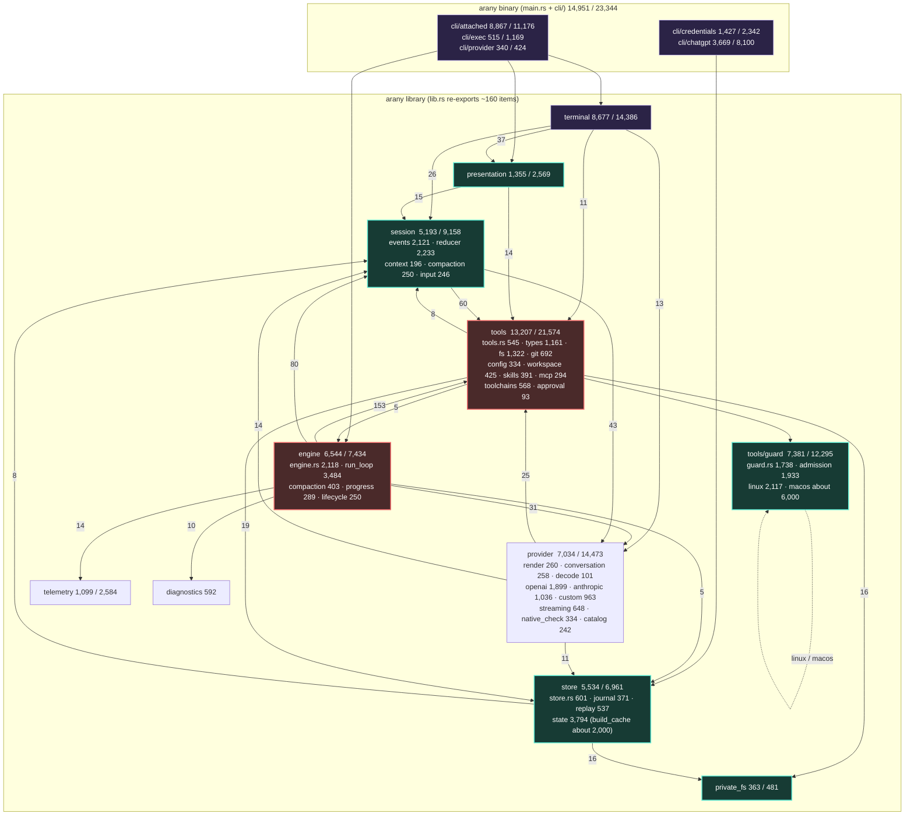
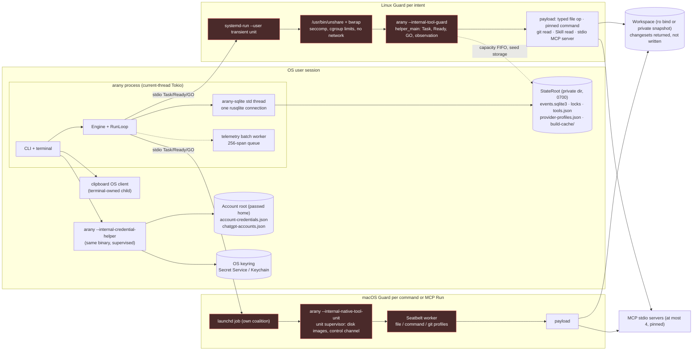
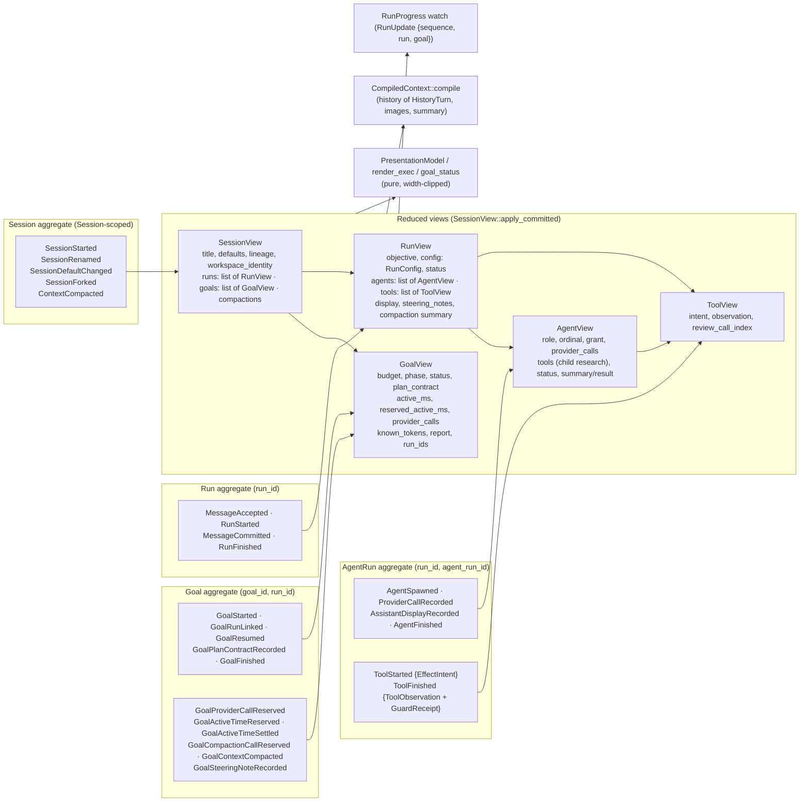
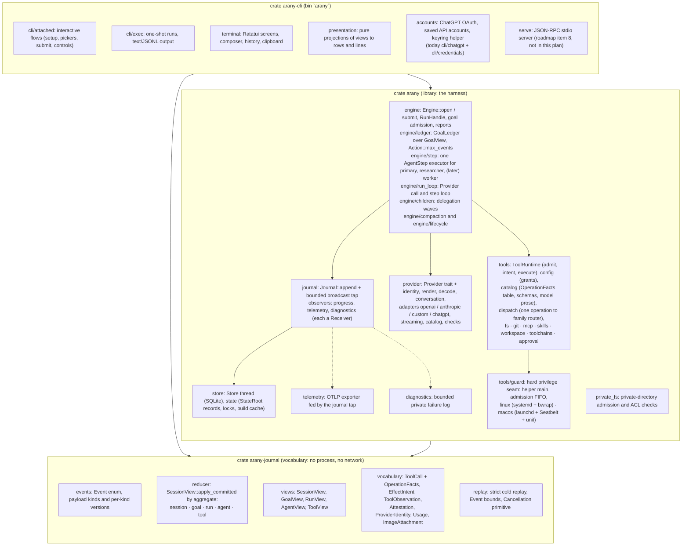
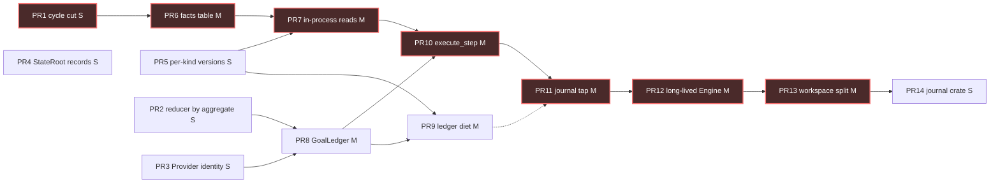

# Architecture refactor diagrams

Supporting diagrams for the [architecture refactor plan](./README.md). Measurements behind the first two diagrams are in [evidence.md](./evidence.md). Measured on `origin/main` at `8857765`.

## 1. Today: module map with fan-in

Box label: module, `n / N` = non-test lines / total lines. Solid arrow: `crate::X` references from the source module to the target (count on the arrow). Dashed arrow: `cfg`-selected platform adapter. Red boxes are shallow, teal boxes are deep, purple boxes are edges.



## 2. Today: runtime flow of one Run

```mermaid
sequenceDiagram
    autonumber
    participant CLI as CLI (attached / exec)
    participant E as Engine::run_turn
    participant S as Store (SQLite thread)
    participant L as RunLoop::execute
    participant R as provider::render
    participant P as Provider adapter
    participant D as provider::decode
    participant T as ToolRuntime (Policy)
    participant G as Guard helper
    participant V as Reducer / views

    CLI->>E: RunRequest {objective, workspace, policy, GoalRequest}
    E->>E: select_provider, validate_request, lock Session + fork ancestors
    E->>S: load_view, admit_run_start (13 + chunk slots)
    E->>E: ToolRuntime::admit, WorkspaceInputs, CompiledContext::compile (376 KiB)
    E->>S: GoalStarted/GoalResumed, GoalRunLinked, MessageAccepted, RunStarted, AgentSpawned
    S-->>V: each append re-validated by apply_committed
    loop one step per Provider call
        L->>L: pause at boundary? steering note? (GoalSteeringNoteRecorded)
        L->>S: GoalActiveTimeReserved, GoalProviderCallReserved
        L->>R: ProviderRequest to Conversation {system, tools, messages}
        R->>P: wire request (Messages / Responses)
        P->>D: tool_use / function_call / structured text
        D-->>L: ProviderOutcome: Finish, Delegate, or Tools (one call)
        L->>S: ProviderCallRecorded, GoalActiveTimeSettled
        alt Tools
            L->>T: intent(call) with limits and result capacity
            L->>S: ToolStarted
            L->>T: approval: human mpsc(1) or AI review call (ToolReview phase)
            T->>G: Task, Ready, GO over stdio (systemd-run + bwrap or launchd + Seatbelt)
            G-->>T: observation + GuardReceipt, or Uncertain
            L->>S: ToolFinished (+ ApplyChangeset integration for commands)
            L->>L: push ToolStep; compact_tool_context_if_needed (2/3 of budget)
        else Delegate
            L->>L: run_children: at most 8 children, JoinSet, at most 16 read-only Tool calls each
            L->>S: AgentSpawned, ProviderCallRecorded, ToolStarted/Finished, AgentFinished per child
            L->>L: RootSynthesis call with child_results
        else Finish
            L->>S: AgentFinished, MessageCommitted, RunFinished
        end
    end
    E->>S: GoalFinished {status, report}
    S-->>V: SessionView / RunView / GoalView
    V-->>CLI: RunProgress watch (coalesced RunUpdate) and RunOutcome
    Note over E,V: autonomous Goal: run_inner repeats run_turn with GoalRequest::resume until the Goal stops
    Note over S,V: replay = Store::load_session then SessionView::replay, never re-executes
```

## 3. Today: process and privilege map



## 4. Today: data model, Events by aggregate



## 5. Target: crates, modules and dependency direction (after PR14)

Every box is named for what it owns. The `arany` library keeps its name so test imports stay valid; `arany-journal` is conditional on roadmap item 8.



## 6. Ordering: PR dependency graph

Critical path in bold: PR1, PR6, PR7, PR10, PR11, PR12, PR13. Edges read "must land before".


